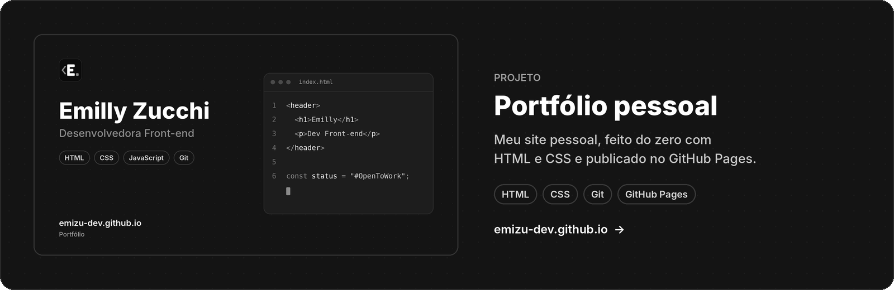

  

  

 

<h2 align="center">Sobre mim</h2>

  Sou de <b>Pernambuco, Brasil</b>, e estudo <b>HTML, CSS, JavaScript</b> e <b>UX Design</b> na Origamid. 
  Vim da área de <b>qualidade e atendimento</b>, e trago esse olhar para os detalhes para o código. 
  Busco minha primeira oportunidade como <b>Desenvolvedora Front-end Júnior</b>.

 

<h2 align="center">Tecnologias e ferramentas</h2>

  

 

<h2 align="center">Projeto em destaque</h2>

  

  
  

 

<h2 align="center">Vamos conversar?</h2>

  
  
  

 

<code>const status = "#OpenToWork";</code>

