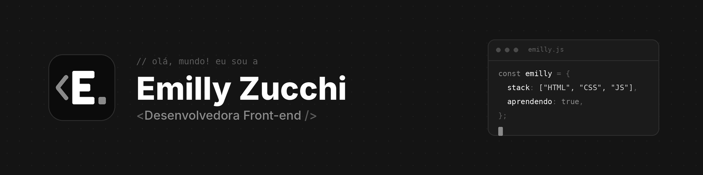
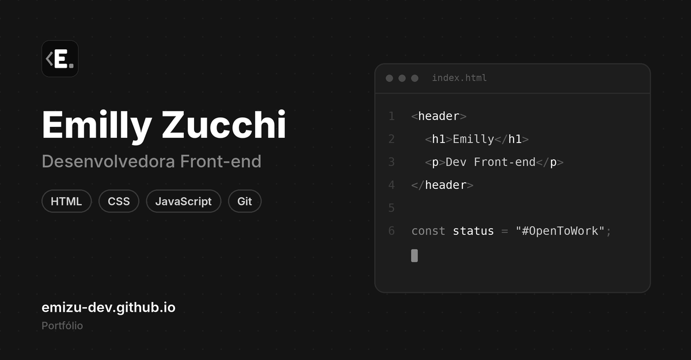

  

  

---

### 👩🏻‍💻 Sobre mim

- 📍 Moro em **Pernambuco, Brasil**
- 🌱 Estudando **JavaScript** e **UX Design** na Origamid
- 🔎 Vim da área de **qualidade e atendimento**, e trago esse olhar para os detalhes para o código
- 🎯 Buscando minha primeira oportunidade como **Desenvolvedora Front-end Júnior**

### 🛠️ Tecnologias e ferramentas

  

### 🚀 Projeto em destaque

<table>
  <tr>
    <td width="45%">
      
    </td>
    <td>
      <h4>Portfólio pessoal</h4>
      
Meu site pessoal, feito do zero com HTML e CSS e publicado no GitHub Pages.

      

        <a href="https://emizu-dev.github.io">🔗 Ver site</a> ·
        <a href="https://github.com/emizu-dev/emizu-dev.github.io">📁 Ver código</a>
      

    </td>
  </tr>
</table>

### 📫 Vamos conversar?

  
  
  

---

  <code>const status = "#OpenToWork";</code>

<!--
**emizu-dev/emizu-dev** is a ✨ _special_ ✨ repository because its `README.md` (this file) appears on your GitHub profile.

Here are some ideas to get you started:

- 🔭 I’m currently working on ...
- 🌱 I’m currently learning ...
- 👯 I’m looking to collaborate on ...
- 🤔 I’m looking for help with ...
- 💬 Ask me about ...
- 📫 How to reach me: ...
- 😄 Pronouns: ...
- ⚡ Fun fact: ...
-->
